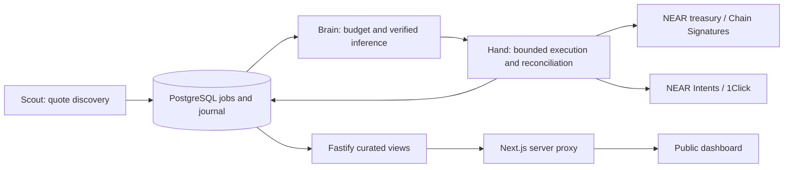

# Architecture and trust boundaries

[Overview](../README.md) · [Judge walkthrough](JUDGING.md) · [API](API.md) · [Operations](OPERATIONS.md)

## Three agents, one durable workflow

[engine.ts](../src/engine.ts) coordinates phases; [store.ts](../src/store.ts)
owns leases, fencing, reservations and the transactional outbox. A crash can
leave work pending, but a new worker reconciles the persisted identity rather
than creating a replacement payment. PAPER uses deterministic provider adapters;
LIVE uses the [provider implementations](../src/providers).

The deployed LIVE runtime is **disarmed**. A separate preparation worker reads
chain state and signed dry quotes without constructing the execution engine.
Human-authorized mainnet fixtures exercised scoped agent-role keys; these were
not decisions made by the automated AI engine. See [verification](VERIFICATION.md).

## Enforcement layers

| Boundary                                          | Enforced checks                                                                                                                                        | Limit of the claim                                                                                          |
| ------------------------------------------------- | ------------------------------------------------------------------------------------------------------------------------------------------------------ | ----------------------------------------------------------------------------------------------------------- |
| [Rust treasury](../contracts/treasury/src/lib.rs) | Roles, approved chains/assets, per-action and daily limits, native reserve, immutable expiring authorizations and one-use constructed signing payloads | Does not verify Cloud credit balances, TEE evidence, commercial revenue or market profitability             |
| Application admission                             | Compute reservation, quote minimums, costs, approved workload measurements and exact response signature                                                | Trusts reviewed configuration and provider evidence; cannot override contract limits                        |
| Scoped NEAR keys                                  | Listed methods on one receiver contract, finite gas allowances                                                                                         | Intents uses separately registered keys; revoking a NEAR key alone does not revoke its Intents registration |
| Viewer boundary                                   | Curated fields and fixed authenticated server routes                                                                                                   | The browser has no backend bearer credential or financial-write API                                         |

The API and workers share a host. Backend orchestration and worker keys are not
themselves inside a TEE. The owner recovery key remains outside the service.
The [private-inference guide](PRIVATE_INFERENCE.md) describes the separate
hardware, provenance, transport and response checks.

## Trading admission

An immediate buy/sell through the same aggregator does not establish an
arbitrage edge. Admission uses the first leg's minimum output as the second
leg's input, then subtracts configured costs from its conservative return.
Slippage protection is not a fee; authenticated quotes are not proof of profit.
The second leg must be requoted after the first settles.

The recorded 10-USDC preview returns 9.840294 USDC. With a 0.20-USDC preview
cost allowance and 0.01-USDC floor, the required return is 10.21 USDC. The
0.369706-USDC shortfall correctly rejects the route before paid inference,
payments or signing. These are quoted estimates, not realized business costs.
See the [recorded market probes](../artifacts/trading-gates-verification.json).

## Revenue and reported costs

The business journal separates investor capital, internal agent payments,
trading P&L and external fee revenue. Closed cycles can crystallize a 15%
performance-fee invoice after reported realized costs and recovery of recorded
customer losses. An invoice is a receivable, not collected revenue.

Receipt recognition requires final successful mainnet execution, matching
Intents events and the exact payer, recipient, asset, amount and post-invoice
time. Each receipt identity is consumed once. This trusts the configured RPC
and `intents.near`; it cannot establish undisclosed ownership or customer demand.
Customer terms, attribution and complete cost valuation remain accountant reports.

Cost windows require compute, native gas, hosting, venue and other realized
expenses, including justified zeros and evidence references. Unknown inference
charges and recorded losses hold new proceeds reservations. Nonoverlapping
closed windows report their own net, not lifetime profit or future runway.
Revenue-token atoms, USD micros and yoctoNEAR remain separate units.

## Proceeds-funded NFT distributions

The implemented, disabled-by-default workflow reserves reported positive net,
validates a signed Intents conversion into wNEAR when needed, verifies final
destination credit, withdraws native NEAR and calls `distribute_revenue` with
the exact reservation-bound deposit. Fixed NFT basis-point entitlements become
pull-claim liabilities; the contract protects those liabilities and rejects
reused distribution references. It does not determine whether a deposit is profit.

An encrypted append-only journal persists signed payment identities before
submission. Recovery reuses exact bytes; unknown payments, refunds and changed
policy remain held. The separately funded accountant pays gas, which must enter
subsequent cost valuation. No business-profit-funded mainnet payout is proven.
Private endpoints are listed in [API](API.md#business-accounting-and-funding).

## Human-in-the-loop metabolic bridge

The bridge monitors reported net from verified receipts and closed cost windows,
reserves proceeds and creates an operator top-up task. A treasury deposit alone
does not qualify as profit. The operator can report a manual purchase using an
organization ID and receipt digest; that report is immutable but unverified.
It does not alter a compute allowance, settle the reservation or open the TEE gate.

No supported customer payment-to-credit adapter is implemented. The observed
Cloud/PingPay checkout is a manual payment flow, not an automation contract.
There is no mock credit API presented as purchased provider credits. See
[provider funding boundaries](PRIVATE_INFERENCE.md#provider-credit-purchases)
and [operational recovery](OPERATIONS.md#business-funding-and-manual-top-ups).

The prepaid `risk-assessment` service reuses the same jobs and inference gates.
Prepayments remain advances until delivery; PAPER and `TEAM_DEMO` orders never
become external revenue. Public customer checkout, automatic refunds and a
delivery portal are unfinished. Real sales remain inappropriate while approved
reports cannot be delivered. This service assesses quoted proposals, not wallet
or smart-contract security.
